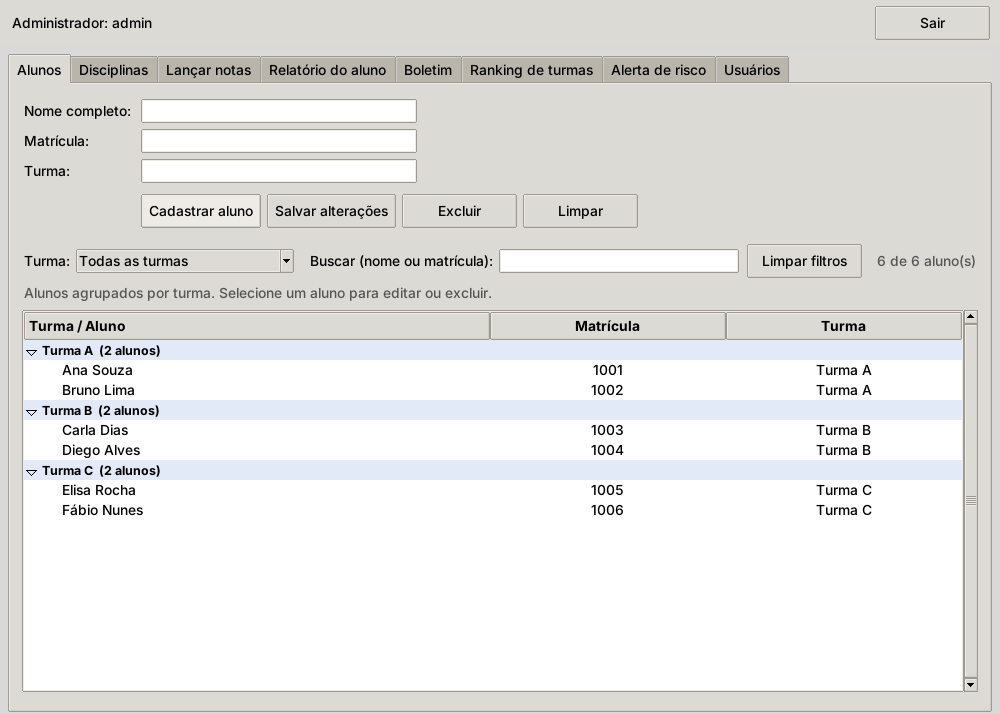
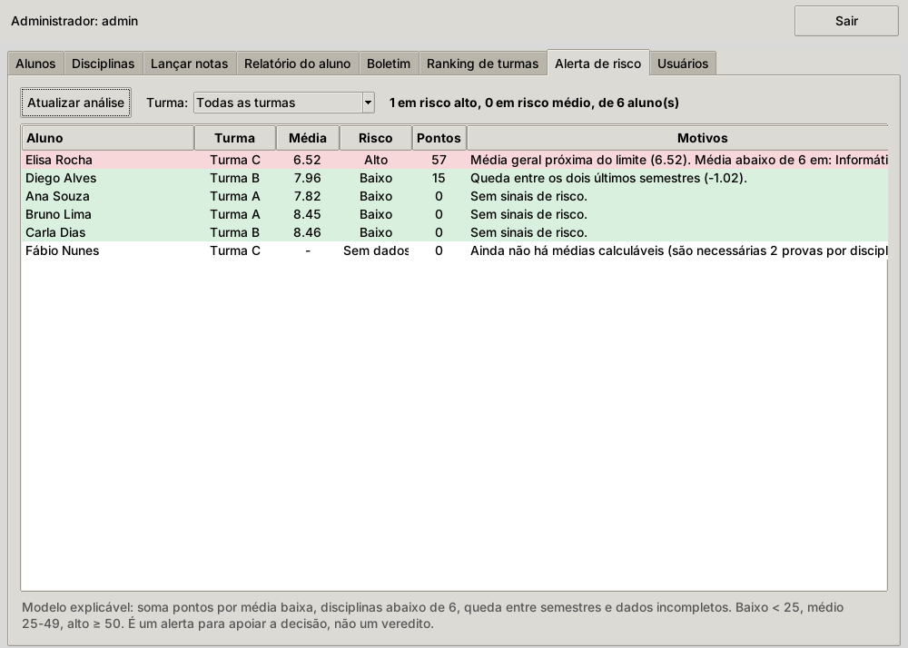

# Sistema de Notas Escolares


Sistema de gestão de notas escolares em Python, com **duas interfaces sobre o
mesmo banco** (Tkinter e terminal) e uma **API REST opcional** — além de um
alerta precoce de risco acadêmico com modelo explicável (não é IA caixa-preta).

## Capturas de tela

| Cadastro de alunos (agrupado por turma) | Alerta de risco acadêmico |
|---|---|
|  |  |

## Funcionalidades

- **Lançamento de notas** por aluno, disciplina e semestre (1 a 4), com três
  provas por disciplina (AVG, AVI, AVC).
- **Médias em cascata**: disciplina → semestre → geral, seguindo a regra
  "soma das duas maiores notas ÷ 2".
- **Ranking de turmas** pela média geral das notas.
- **Alerta precoce de risco acadêmico** (`risco.py`): modelo de pontos
  explicável — soma pontos por média baixa, disciplinas abaixo de 6, queda
  entre semestres e dados incompletos. Classifica baixo/médio/alto e mostra
  o motivo de cada pontuação, não é modelo de ML treinado.
- **Autenticação por perfil** (administrador, professor, consulta), com
  bloqueio de 5 minutos após 5 tentativas de senha inválidas.
- **API REST** documentada (Swagger em `/docs`), com modo demo em memória
  pra testar sem precisar de banco.
- **Testes automatizados** (`tests/`, `python -m unittest discover tests`).

## Como executar

```bash
pip install -r requirements.txt
```

**Interface gráfica ou terminal**, contra um MongoDB Atlas real:

```bash
set MONGODB_URI=mongodb+srv://...      # PowerShell: $env:MONGODB_URI="..."
python tela.py      # interface gráfica (Tkinter)
python main.py      # terminal
```

A string de conexão nunca vai no código — sempre pela variável de ambiente
`MONGODB_URI` (veja `.env.example`). Opcional: defina `ADMIN_SETUP_CODE`
antes do primeiro acesso para exigir um código na criação do administrador.

**Sem banco, pra só testar** (usa `mongomock`, dados somem ao fechar):

```bash
pip install mongomock
python demo.py
```

**API REST:**

```bash
python api.py --demo      # dados de exemplo em memória
python api.py             # banco real (precisa de MONGODB_URI)
```

Abra `http://127.0.0.1:8000/docs`. Primeiro `POST /primeiro-acesso` (cria o
administrador), depois `POST /login` (devolve o token) e use o botão
**Authorize** do próprio `/docs`.

## Regras de negócio

- Nota por aluno + disciplina + semestre (1 a 4), com provas AVG, AVI e AVC (0 a 10).
- Média da disciplina = soma das duas maiores notas ÷ 2 (precisa de 2 notas).
- Média do semestre = média das disciplinas; média geral = média dos semestres.
- Ranking de turmas = média das médias de todas as notas da turma.
- Senha do administrador: mínimo 8 caracteres, com letras e números.
- 5 tentativas inválidas bloqueiam o usuário por 5 minutos (registrado no banco).
- Excluir aluno ou disciplina (só na tela) apaga também as notas ligadas a ele.
- Notas antigas por bimestre (campo `nota`) não são mais lidas pelo sistema.

## Estrutura do projeto

| Arquivo | Responsabilidade |
|---|---|
| `calculos.py` | Regras de média, boletim e ranking (usado pelas duas interfaces) |
| `autenticacao.py`, `banco.py`, `config.py` | Login, conexão e índices |
| `risco.py` | Alerta de risco acadêmico |
| `tela.py` | Interface gráfica (Tkinter) |
| `main.py`, `interface.py`, `cadastros.py`, `notas.py`, `consultas.py`, `relatorios.py`, `entrada.py` | Interface de terminal |
| `graficos.py` | Gráfico de médias (matplotlib) |
| `api.py` | API REST (FastAPI) |
| `tests/` | Testes automatizados |
